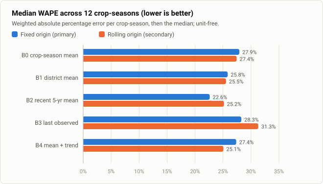
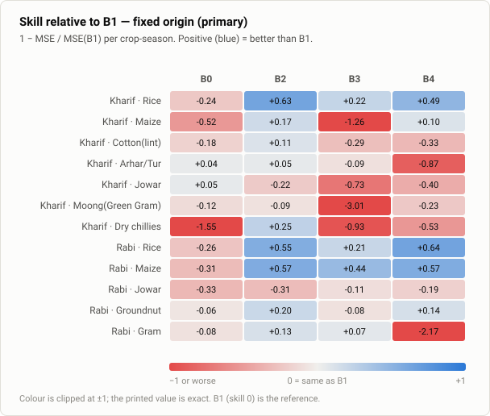

# Telangana Crop Intelligence — Historical Yield Baselines

Transparent, reproducible baselines for forecasting **district-level crop yield in Telangana** from historical production records, evaluated with a strict time-based protocol.

This is a final-year B.Tech research project. It answers one question: *how accurately can simple rules based only on past records forecast next season's district yield?* The answer sets the bar any future machine-learning model must clear. These are benchmarks, **not production-ready agricultural forecasts.**

---

## Problem and motivation

Crop-yield models are often reported with headline accuracy figures obtained from random train/test splits. With panel data, near-duplicate rows and future years leak into training, so those figures overstate real forecasting skill. Before building anything more complex for Telangana, this project measures what honest, leakage-controlled forecasting from history alone achieves:
- per district,
- per crop and season,
- in each crop's own units.

## Key features

- **Five transparent baselines (B0–B4).** Every prediction traces back to its source CSV line and the rule that produced it.
- **Two time-based evaluation designs.** Fixed origin is primary; rolling origin is secondary. There is no random splitting.
- **Leakage controls enforced in code.** Run-time assertions check that training-period statistics never use test years, and the tests confirm that predictions don't change when test-year values are altered.
- **Independent verification.** A separate pure-Python re-implementation recomputes all 4,290 predictions from the raw CSV.
- **Unit-aware reporting.** Native-unit errors are reported per crop-season only. Cross-crop comparisons use unit-free WAPE and skill. Nothing is pooled across incompatible units.
- **Byte-for-byte reproducibility.** Each run writes a manifest of SHA-256 hashes, and repeat runs are compared file by file.
- **Minimal dependencies.** NumPy and pandas only, hash-locked. Tests use the standard-library `unittest`.

## Methodology

**Data scope.**
- Telangana, 9 districts (Hyderabad excluded for short coverage).
- 12 crop-season combinations:
  - Kharif: Rice, Maize, Cotton(lint), Arhar/Tur, Jowar, Moong(Green Gram), Dry chillies.
  - Rabi: Rice, Maize, Jowar, Groundnut, Gram.
- Rows with missing or zero production, or area below 10 ha, are excluded. That removes 12 core rows, leaving **1,802 eligible district-year observations**.
- **Target:** yield = production ÷ area, in each crop's recorded units: t/ha, except cotton in bales/ha (unconverted).

**Baselines.** Each is computed only from the forecast's information set: eligible rows of the same crop-season up to its training cutoff.

| ID | Baseline | Rule | Fallback |
|---|---|---|---|
| B0 | Crop-season mean | Mean of all information-set rows | — |
| B1 | District historical mean | District mean (≥5 years) | B0 |
| B2 | Recent five-year district mean | District mean over `[origin−4, origin]` (≥3 rows) | B1, then B0 |
| B3 | Last observed district yield | Most recent value within `[origin−2, origin]` | B1, then B0 |
| B4 | District mean + trend | B1 + β·(target − district's mean year); β = Telangana-wide **within-district** OLS slope | B0 + trend, or B0 |

B4 predictions are never clipped. Negative values would be kept and flagged; none occurred.

**Metrics** (e = prediction − observed):
- MAE, RMSE and bias = mean(e), all in native units.
- WAPE = Σ|e| / Σ|observed|.
- Skill vs B1 = 1 − MSE/MSE(B1). "Beats B1" means skill > 0.

Full definitions are in [`reports/research_report.md`](reports/research_report.md) §4 and [`configs/tg_baselines_v1.json`](configs/tg_baselines_v1.json).

## Fixed origin vs rolling origin

| Design | Role | Training data used for each test year |
|---|---|---|
| **Fixed origin** | Primary | Always 1997–2009, for every target year (2010, 2011, 2013, 2014). It simulates forecasting several years ahead from one point in time |
| **Rolling origin** | Secondary | Every year strictly before the target: ≤2009 → 2010, ≤2010 → 2011, ≤2011 → 2013, ≤2013 → 2014. It simulates updating the forecast each season |

2012 is absent from the Telangana records, so the 2013 rolling forecast uses data through 2011. Both designs score exactly the same 429 test rows: 11 crop-seasons × 36, plus 33 for Kharif Jowar.

## Results

Verified from [`results/tg_baselines_v1/baseline_summary.csv`](results/tg_baselines_v1/baseline_summary.csv). Medians are taken across the 12 crop-seasons; "beats B1" counts crop-seasons with skill > 0.

| Baseline | Fixed: median WAPE | Fixed: median skill vs B1 | Fixed: beats B1 | Rolling: median WAPE | Rolling: median skill vs B1 | Rolling: beats B1 |
|---|---:|---:|---:|---:|---:|---:|
| B0 crop-season mean | 27.9% | −0.207 | 2 / 12 | 27.4% | −0.250 | 2 / 12 |
| B1 district mean (reference) | 25.8% | 0 | — | 25.5% | 0 | — |
| **B2 recent 5-year mean** | **22.6%** | **+0.150** | **9 / 12** | 25.2% | +0.031 | 7 / 12 |
| B3 last observed | 28.3% | −0.098 | 4 / 12 | 31.3% | −0.394 | 4 / 12 |
| B4 mean + trend | 27.4% | −0.210 | 5 / 12 | 25.1% | +0.011 | 6 / 12 |

**Findings:**
- **Recent history beats long history in most crop-seasons.** Under fixed origin, B2 was strongest for Rice (skill +0.63 Kharif, +0.55 Rabi) and Rabi Maize (+0.57). Its advantage is much smaller under rolling origin.
- **Long-run means under-predict.** B1 was too low in 41 of 48 crop-season × year cells (fixed origin): yields in 2010–2014 were generally above 1997–2009 levels.
- **B3 is fragile.** 2009 was atypical for several crops; Kharif Moong yields that year were at a median 0.25× of each district's historical mean.
- **B4 overshoots when past trends stop.** Rabi Gram skill was −2.17 under fixed origin.
- **Errors remain large.** The lowest-RMSE baseline per crop-season still has a WAPE between 8.7% and 34.1% (fixed origin).

Per-crop-season results in native units are in [`metrics_by_crop_season.csv`](results/tg_baselines_v1/metrics_by_crop_season.csv), with discussion in the [research report](reports/research_report.md) §5–6. A one-page summary is in [`reports/executive_summary.md`](reports/executive_summary.md).

### Figures

Generated from the published aggregate files by `scripts/make_figures.py`.





More figures:
- [`skill_vs_b1_rolling_origin.svg`](docs/figures/skill_vs_b1_rolling_origin.svg): skill relative to B1, rolling origin.
- [`coverage_observations.svg`](docs/figures/coverage_observations.svg): eligible observations per crop-season.

There are no observed-versus-predicted plots, because they would publish record-level values from a dataset whose redistribution rights are unverified. They can be produced locally from `predictions.csv`.

## Limitations and test-set exposure

Please read these before using or citing the results.

1. **Test-set exposure.** The test years were excluded from every computation; there is no computational leakage. They were **not unseen**, however:
   - Descriptive statistics that included test-period yields, and one development run's summary scores, were viewed before the code was locked.
   - That run's outputs are byte-identical to the final run, so no result changed afterwards.
   - Whether the earlier descriptive exposure influenced design choices (crop selection, the 10 ha cutoff, coverage thresholds, baseline windows) **cannot be determined and remains unknown**.
   - See report §9.
2. **Inferred production units.** The source has no unit column. Tonnes are assumed; cotton is assumed to be bales and is not converted. Paddy vs milled rice and pod vs kernel groundnut are unstated.
3. **Unconfirmed `Crop_Year` convention.** It may be a calendar year or an agricultural year. This doesn't matter for these baselines but does for any future weather alignment.
4. **Data ends in 2014.** 2012 is missing, and only the 10 pre-2016 districts are covered; Telangana now has 33.
5. **Small, correlated test sample.** 4 test years × at most 9 districts, with errors correlated within a year. Skill differences smaller than about ±0.1 shouldn't be treated as meaningful, and no confidence intervals were computed.
6. **No weather, irrigation or input data**, by design.
7. **District-level aggregates**, not farm-level yields.
8. **Unresolved licences** for the source code and dataset (see below).

## Installation

Requires **Python 3.11**.

```bash
git clone https://github.com/Yafai01/telangana-crop-intelligence.git
cd telangana-crop-intelligence
uv venv --python 3.11 .venv
uv pip sync requirements.lock.txt --python .venv/bin/python --require-hashes --only-binary :all:
# Windows: use .venv\Scripts\python.exe; pip alternative: see docs/reproducibility.md
```

Then obtain the dataset as described in [`data/README.md`](data/README.md) and verify it:

```bash
python -I -B scripts/verify_dataset.py
```

## Running tests and reproducing the experiment

Run these from the project root, with the environment activated:

```bash
# tests (dataset-dependent tests are skipped if the dataset is absent)
python -I -B -m unittest discover -s tests -v

# run both evaluation designs (fixed and rolling origin)
python -I -B src/tg_baselines.py --config configs/tg_baselines_v1.json --out runs/run_a

# validate the run, including a byte-for-byte comparison with the published results
TCI_RUN_DIR=runs/run_a python -I -B -m unittest discover -s tests -v

# repeat the run and compare (all files except run_timing.json must be identical)
python -I -B src/tg_baselines.py --config configs/tg_baselines_v1.json --out runs/run_b
python -I -B src/compare_runs.py --config configs/tg_baselines_v1.json --run-a runs/run_a --run-b runs/run_b --report runs/reproducibility_report

# analysis tables and figures
python -I -B scripts/summarize_results.py --config configs/tg_baselines_v1.json --run runs/run_a --out runs/run_a_analysis
python -I -B scripts/make_figures.py
```

To keep the dataset outside the repository, use `--data PATH` and set `TCI_DATA`. Output files and determinism are explained in [`docs/reproducibility.md`](docs/reproducibility.md).

## Project structure

```
configs/tg_baselines_v1.json   experiment definition: scope, exclusions, designs, baselines, metrics
src/tg_baselines.py            experiment (B0-B4, both designs, leakage assertions, outputs)
src/compare_runs.py            file-by-file reproducibility comparison
scripts/verify_dataset.py      check a local copy of the dataset (SHA-256, schema)
scripts/summarize_results.py   derived report tables
scripts/make_figures.py        SVG figures from published aggregates
tests/test_tg_baselines.py     unit, leakage, real-data, output, published-result and hygiene tests
data/README.md                 how to obtain and verify the (not included) dataset
results/tg_baselines_v1/       published aggregate results, manifest, analysis tables, reproducibility check
reports/                       research report and executive summary
docs/                          reproducibility guide and figures
requirements.in / requirements.lock.txt   direct and hash-locked dependencies
```

`data/raw/` and `runs/` are git-ignored. They hold the dataset and local record-level outputs, which must not be committed.

## Contributing

See [`CONTRIBUTING.md`](CONTRIBUTING.md). In short:
- keep the evaluation protocol fixed;
- add tests for any change;
- never commit the dataset or record-level outputs;
- report results per crop-season, without pooling across units.

## Citation

Citation metadata is in [`CITATION.cff`](CITATION.cff). If you use this work, cite the repository and state the test-set-exposure and data-rights caveats above.

## Licence and data rights

- **Code and documentation in this repository:** written for this project. They do not copy code from the repository that originally supplied the dataset. *No licence has been chosen yet;* until a `LICENSE` file is added, all rights are reserved by the author.
- **Dataset:** not included. Its provenance and licence are unverified (see [`data/README.md`](data/README.md)). The repository it was taken from has no licence file.
- **Published results:** aggregate statistics derived from that dataset. Their redistribution status depends on the dataset's terms, which are unresolved.
